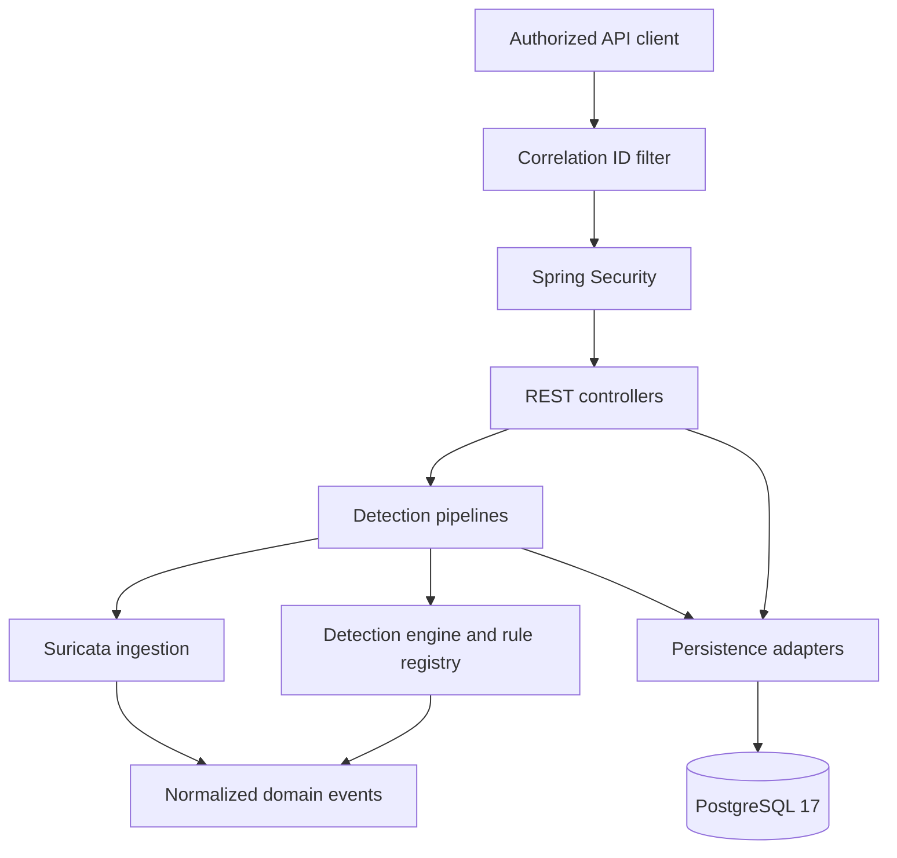
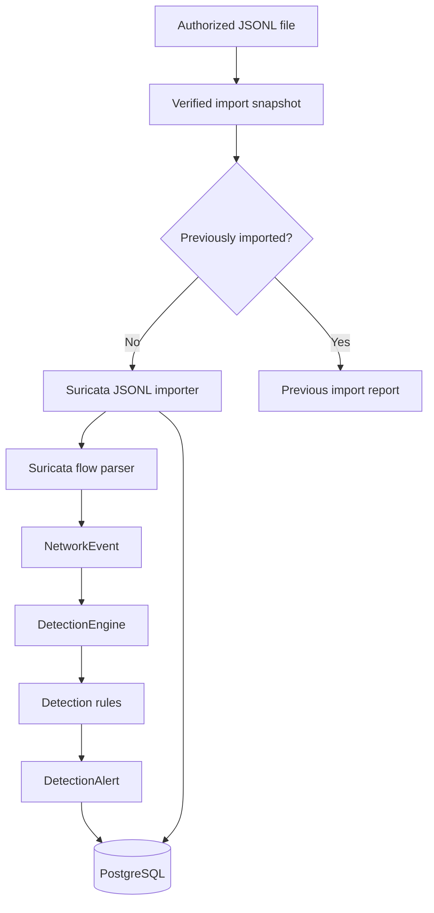
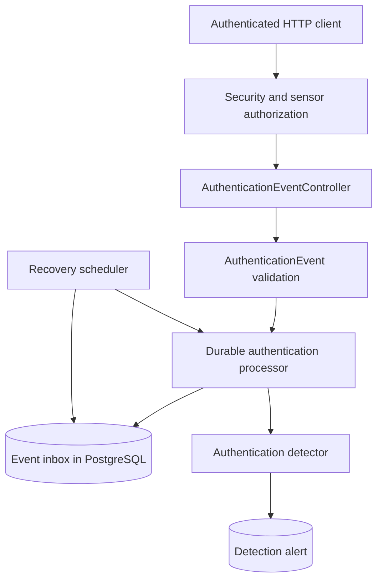
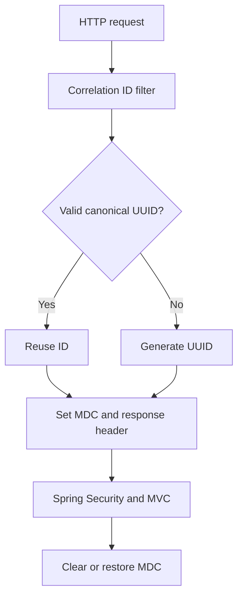

# AEGIS — Architecture Diagrams

Roadmap: AEGIS-021.
Status: current-state baseline.

## 1. Modular monolith

This is a conceptual component map, not an exact
Spring dependency or authorization sequence diagram.

## 2. Suricata processing

The pipeline verifies the original source before
completing import processing.

## 3. Auth-event ingestion

The diagram summarizes logical responsibilities.
It does not specify every transaction or retry branch.

## 4. Request correlation

## Limitations

- No Zeek integration is represented as implemented.
- Durable per-event evidence references remain pending.
- Rule execution versioning remains pending.
- Diagrams must be reviewed when integration changes.
